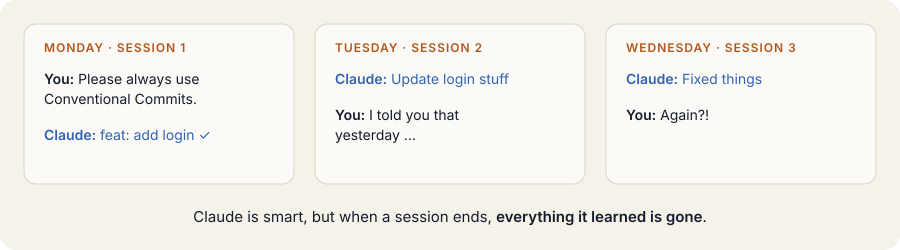
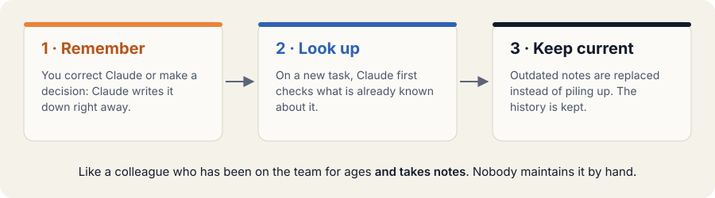
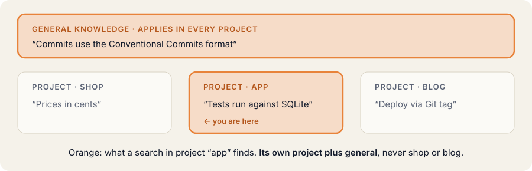
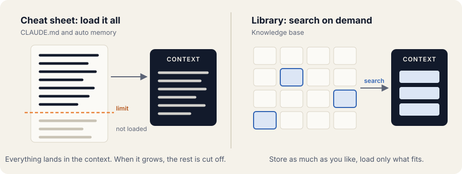
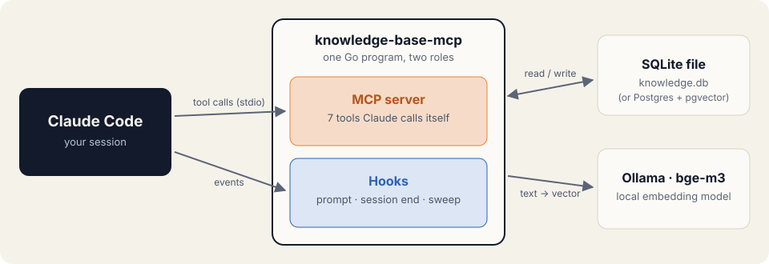

# Knowledge Base for Claude Code

[](https://github.com/Bibob7/knowledge-base/actions/workflows/ci.yml)

**A memory for Claude Code.** Claude remembers corrections, decisions and verified facts across sessions and
projects, finds them again when they matter, and replaces what is outdated. Everything stays on your machine.



## The idea



- **Remember.** When you correct Claude or make a decision, Claude writes it down right away. What slips through
  is picked up by a review when the session ends.
- **Look up.** On every prompt, the few notes that match the task are added to the context automatically.
- **Keep current.** A new fact that contradicts an old one replaces it. The old one is kept as history.

Notes belong either to one project (the repository) or apply everywhere, like your personal preferences:



Only what you cannot read from the code is stored: corrections, preferences, decisions and verified facts.
Secrets are rejected. → [More about the idea](docs/concept.md)

## Why not just CLAUDE.md or auto memory?



CLAUDE.md and Claude Code's auto memory are loaded at the start of a session, up to a limit, and auto memory is
kept per repository. The knowledge base searches on every prompt instead: it can grow large, shares general
knowledge across all your projects, and keeps the history of what it replaced. It complements CLAUDE.md, which
stays the place for fixed rules. → [Built-in memory compared](docs/concept.md#doesnt-claude-already-remember) ·
[Other memory plugins compared](docs/comparison.md)

## Under the hood



- **One Go program, two roles:** an MCP server with seven tools Claude calls itself (`remember`, `supersede`,
  `search_knowledge`, …), and hooks Claude Code starts on every prompt and at session end.
- **Hybrid search:** meaning (vectors from a local embedding model, `bge-m3` via Ollama) plus exact words
  (full-text index), merged by rank.
- **One SQLite file** by default; Postgres with pgvector for a team server.
- **Fast and quiet:** about 80 ms per search over 10,000 chunks; hooks never block a session.

→ [How it works](docs/how-it-works.md), with every term explained

## Install

You need [Ollama](https://ollama.com/download) for the local embeddings. Then, in Claude Code:

```
/plugin marketplace add Bibob7/knowledge-base
/plugin install knowledge-base@bibob7
/knowledge-base:setup
```

Run `/reload-plugins`, and you are done. From now on Claude remembers and looks up on its own.
`/knowledge-base:viz` shows your knowledge as a map in the browser.

macOS and Linux. → [Installation details, options and configuration](docs/operations.md)

## Documentation

| | |
|---|---|
| [The idea](docs/concept.md) | what it does, what is stored, privacy, comparison with built-in memory |
| [How it works](docs/how-it-works.md) | architecture, embeddings, hybrid search, hooks, learning at session end, glossary |
| [Comparison](docs/comparison.md) | claude-mem, Mem0, Basic Memory and others |
| [Operations](docs/operations.md) | installation, databases, configuration, commands, embedding model, scaling, backups |
| [Development](docs/development.md) | working copy, tests, releases |

## License

[MIT](LICENSE)
