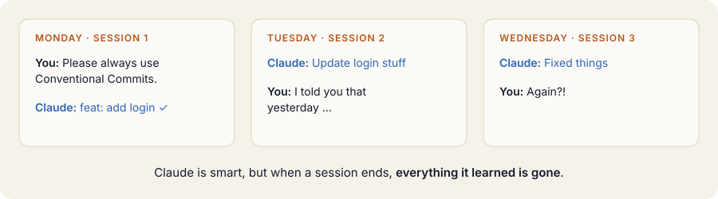
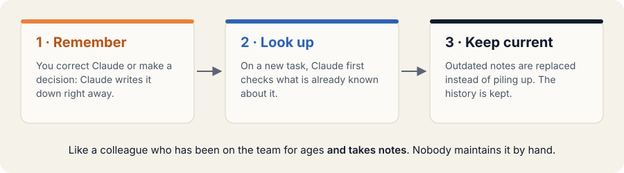
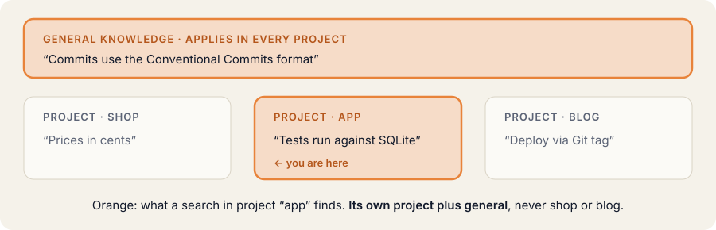
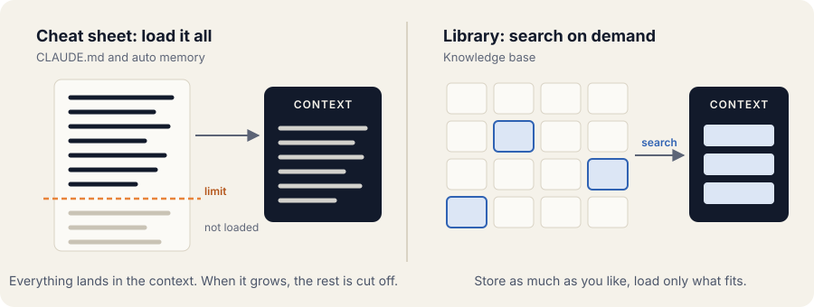

# The idea

This page explains what the knowledge base does and why it exists, without technical terms.
[How it works](how-it-works.md) goes under the hood.

## The problem: every session starts from zero

You explain a convention, a decision or a pitfall of the project to Claude. In the next session it is
forgotten, because every session starts with an empty context. You keep repeating yourself.

## The solution: a notebook Claude keeps itself

The knowledge base is a notebook with three activities:

- **Remember.** When you correct Claude or make a decision, Claude writes it down right away.
- **Look up.** On a new task, Claude first checks what is already known about it.
- **Keep current.** Outdated notes are replaced instead of piling up. The history is kept.

Claude keeps the notebook itself; nobody has to maintain it by hand.

### What it feels like day to day

1. **Monday, project A.** You correct Claude once: "We use Conventional Commits."
2. **Right away.** Claude creates a note that applies to all projects.
3. **Thursday, project B.** A new session. You only write: "Please commit the changes."
4. **Automatically.** The note is injected, and the commit reads `feat(auth): add login`.

You explain something once, not in every session.

## What goes into the notebook, and what does not

| Remembered | Left out |
|---|---|
| Corrections: "No, we do it like this …" | Anything already in the code or in Git |
| Preferences and decisions, ideally with the reason | Intermediate state and guesses |
| Verified facts you cannot see in the code | Passwords, keys, tokens (actively rejected) |

Each note is one fact in 1–5 sentences that makes sense without the conversation. A few strong notes beat many
weak ones. Anything you can read in the code or the Git history is deliberately not stored, because it would go
stale.

## Project knowledge and general knowledge

- **Project knowledge** belongs to one repository. Its name is the repository's folder name.
- **General knowledge**, such as your preferences, applies in every project.
- A search always covers the current project plus general knowledge. Other projects stay out.

Git worktrees, as agents use them, map to the repository they were created from. Details:
[Project names](operations.md#project-names).

## Everything stays on your machine

- **One file.** The whole notebook is a single SQLite file in your home folder.
- **Local AI.** Search by meaning is computed by a small model on your machine (Ollama).
- **One exception.** The review at session end uses your Claude plan, so the transcript goes to the same
  provider as the session itself. Turn it off with `KB_AUTO_LEARN=0`.

## Doesn't Claude already remember?

Claude Code has two built-in mechanisms. Both are useful, and the knowledge base complements them rather than
replacing them.

| | CLAUDE.md | Auto memory | Knowledge base |
|---|---|---|---|
| **Who writes it?** | you, by hand | Claude, during the session | Claude, plus a review at session end |
| **What enters the context?** | all of it, at every start | an index at start, at most 200 lines or 25 KB | only matching notes, fresh on every prompt |
| **How is it found?** | not at all, it is just there | Claude opens files when needed | search by meaning and by words |
| **Applies to** | project, user or organization | one repository on one machine | project plus cross-project |
| **Outdated entries** | you clean up | Claude edits or deletes | replaced, history kept |

The memory of the Claude app covers chats on the web, desktop and mobile, not Claude Code sessions.

Sources (vendor documentation): [How Claude remembers your project](https://code.claude.com/docs/en/memory),
[Claude Help Center: memory](https://support.claude.com/en/articles/11817273).

### Cheat sheet or library?

The built-in mechanisms work like a cheat sheet taped to the monitor: everything is on it and gets read in full
every time. That is great for a few fixed rules, but it fills up, and whatever goes past the limit is missing.
The knowledge base works like a library with a catalog: it can grow large, because each question only fetches the
matching notes.

**Complement, don't replace:** CLAUDE.md stays the place for fixed rules that should always apply. The knowledge
base holds what is learned along the way.

**When the knowledge base pays off:** you work in many repositories and want general knowledge to follow you, the
collected knowledge outgrows a few hundred lines, or a team should share one memory. For a single project with
little to remember, auto memory is enough. To check this with your own data, run
[`scripts/usage-report.py`](operations.md#usage-report).

How the knowledge base compares with other memory plugins: [Comparison](comparison.md).
