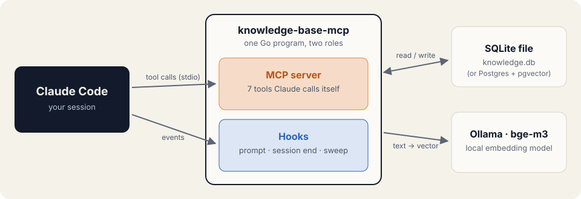
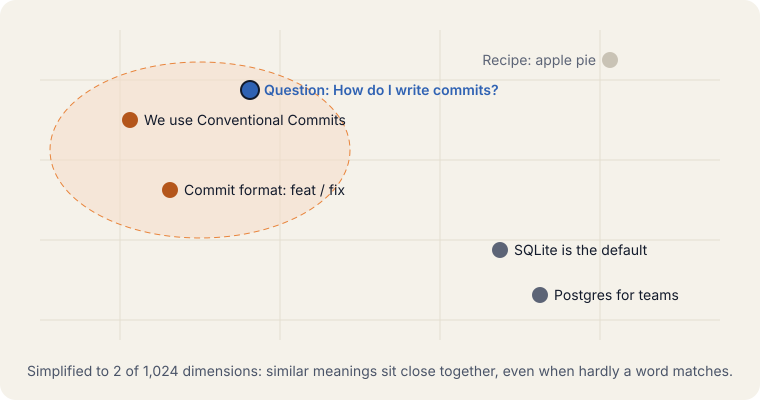
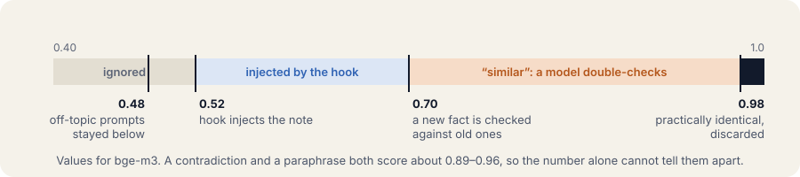
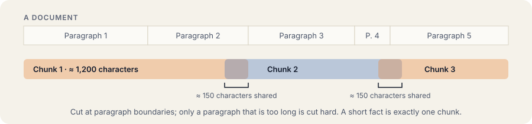
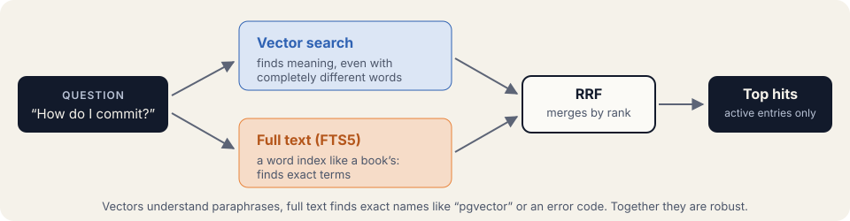
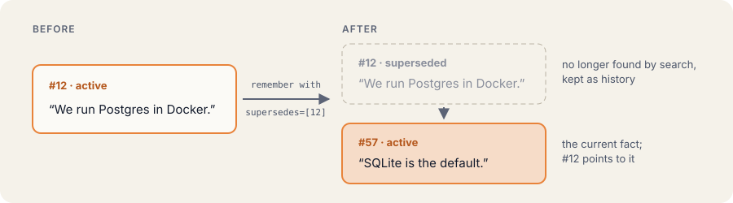
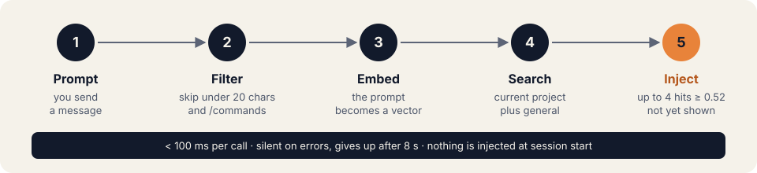
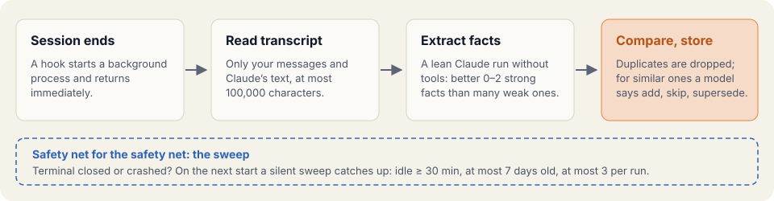

# How it works

Every term is explained where it first appears; the [glossary](#glossary) at the end repeats them in one
sentence each. Configuration and commands are in [Operations](operations.md).

- [Architecture](#architecture)
- [Search by meaning](#search-by-meaning)
- [Maintaining the memory](#maintaining-the-memory)
- [Glossary](#glossary)

## Architecture



A single Go program, `knowledge-base-mcp`, has two roles:

- As an **MCP server** it offers tools that Claude calls when it thinks they make sense.
- As **hooks** it is started by Claude Code on events, for example on every prompt, without the model deciding.

Tools are for deliberate remembering and searching; hooks are the safety net. The data lives in a SQLite file
(or Postgres), and Ollama turns texts into vectors locally.

| Term | Meaning |
|---|---|
| **Plugin** | An extension package for Claude Code. It ships the server, hooks and skills in one go. |
| **MCP** | "Model Context Protocol": an open standard through which AI assistants call tools. |
| **MCP server** | A program that offers tools over MCP, here `knowledge-base-mcp`. |
| **Tool** | A function Claude calls on its own, such as `remember` or `search_knowledge`. |
| **Hook** | A program Claude Code starts automatically on an event, e.g. on every prompt. |
| **stdio** | Standard input and output: Claude Code starts the server locally and talks to it through pipes, no network. |

What the plugin ships:

| Part | What it does |
|---|---|
| MCP server `kb` (`.mcp.json`) | the tools below; its server instructions tell Claude when to search, remember and supersede |
| Hooks (`hooks/hooks.json`) | retrieval per prompt, learning at session end, silent sweep of crashed sessions |
| Skill `/knowledge-base:setup` | setup, repair and status |
| Skill `/knowledge-base:viz` | opens the [visualisation](operations.md#visualisation) in the browser |
| Skill `/knowledge-base:consolidate` | reviews duplicates and unused entries (see [Keeping the memory lean](#keeping-the-memory-lean)) |

### The seven tools

| Tool | Purpose |
|---|---|
| `remember` | Store a short fact. Returns similar existing entries so that contradictions are noticed. With `supersedes` it replaces old entries. |
| `supersede` | Mark entries as outdated. They are no longer found but are kept as history. |
| `search_knowledge` | Hybrid search over active entries; with `project`: that project plus cross-project knowledge |
| `list_documents` | List entries with their usage counters, e.g. "what was learned recently" (`include_superseded` also shows outdated ones, `unused_days` only entries nobody used for that long) |
| `get_document` | Read one entry by its ID |
| `add_document` | Store a longer document; the same `source` replaces the old one |
| `delete_document` | Delete for good, only for junk or on request; entries it had superseded become current again |

Entries have an optional `project` (empty = cross-project), a `kind` (`fact` or `document`) and a `status`
(`active` or `superseded`). Texts containing obvious secrets (keys, tokens, passwords) are rejected.

When Claude uses which tool is defined in the server instructions
([`cmd/knowledge-base-mcp/instructions.md`](../cmd/knowledge-base-mcp/instructions.md), embedded in the binary).
Claude Code puts them into the system prompt and cuts them after 4096 characters; a test guards the size. In
short: on a task, search first; on corrections, decisions and findings, call `remember` immediately; replace
outdated entries with `supersede`.

## Search by meaning

### Embeddings: meaning as numbers



An **embedding model** turns a text into a long list of numbers, a **vector**. With `bge-m3` that is 1,024
numbers: "We use SQLite" → `[0.021, −0.334, 0.118, …]`. Think of coordinates on a map of meanings: similar things
sit close together, even when hardly a word matches. That is why the question "How do I write commits?" finds the
note about Conventional Commits.

### How similar? Measure the angle

**Cosine similarity** measures how much two vectors point in the same direction, in other words how close two
meanings are: 1.0 means the same direction and meaning, about 0.5 loosely related, about 0 nothing to do with
each other.

### Thresholds: when does something match?



What a similarity value means depends on the model. For `bge-m3` it was calibrated on the real knowledge base:

| Value | Meaning |
|---|---|
| 0.48 | off-topic prompts all stayed below this in testing |
| **0.52** | the prompt hook injects a note (`KB_HOOK_MIN_SIM`) |
| **0.70** | "similar": a new fact is checked against old ones by a second model call (`KB_SIMILAR_MIN_SIM`) |
| **0.98** | practically identical: discarded as a duplicate |

A contradiction ("We use SQLite" instead of "… Postgres") and a mere paraphrase both score about 0.89–0.96.
The number alone cannot tell them apart, so similarity never discards a correction by itself.

### Chunks: splitting long texts



A **chunk** is a piece of text that gets its own vector. One vector for a whole manual would be too blurry to
find details, so long documents are split at paragraph boundaries into pieces of about 1,200 characters; only a
paragraph that is too long is cut hard. About 150 characters of overlap keep thoughts that sit right on the cut.
Short facts from `remember` are usually exactly one chunk. Both values are configurable (`CHUNK_SIZE`,
`CHUNK_OVERLAP`).

### Hybrid search: two searches, one result



Search runs on two tracks:

- **Vector search** finds meanings, even with completely different wording.
- **Full-text search** (**FTS5** in SQLite, `tsvector` in Postgres) works like the index at the back of a book.
  It finds exact terms such as tool names or error codes, where vectors sometimes miss. It lower-cases words
  and does no stemming, so German and English both work (SQLite also folds diacritics: "uber" finds "über").

Only active entries are searched. With a project, the search covers that project plus cross-project knowledge.

### RRF: count ranks, not scores

The two searches return incomparable scores (cosine values versus text relevance), so they cannot simply be added.
**Reciprocal Rank Fusion** ignores the scores and only looks at the ranks:

```
points = Σ 1 / (60 + rank)
```

Each list awards points by rank, and whatever appears in both lists collects twice. 60 is the usual value from the
original paper (Cormack et al., 2009); it dampens the lead of rank 1 so that no single list dominates. Each list
contributes its top 50 hits.

| Entry (made-up example) | Vector | Full text | Points |
|---|---|---|---|
| Conventional Commits | 1st | 3rd | 1/61 + 1/63 = **0.0323** |
| Commit hook | 4th | 1st | 1/64 + 1/61 = **0.0320** |
| Release tags | 2nd | – | 1/62 = 0.0161 |
| GPG signing | – | 2nd | 1/62 = 0.0161 |

The two entries both searches found end up on top, although neither is first everywhere.

## Maintaining the memory

### Life of a note: replace, don't pile up



A memory that only grows eventually contradicts itself. So entries are replaced instead of piled up:

- **Notice contradictions.** `remember` returns similar entries. If an old one no longer holds, it is replaced
  right away (`remember` with `supersedes`, or `supersede`).
- **Keep the history.** Outdated entries vanish from search, but the chain stays traceable. The
  [visualisation](operations.md#visualisation) shows it as dashed lines.
- **Deleting is the exception.** Only for junk. Whatever the deleted entry had replaced becomes current again.

### On every prompt: the injection hook



A `UserPromptSubmit` hook feeds knowledge that matches the task into the context:

1. Prompts under 20 characters and slash commands are skipped.
2. The prompt is embedded and searched in the current project plus general knowledge.
3. Up to 4 hits above the threshold (0.52 for `bge-m3`) are prepended as context, headed "Knowledge from the
   knowledge base". Whatever was already injected in the session is not injected again; after `/compact`
   earlier entries may be injected again, since the context is then only a summary.

The hook never gets in the way: on errors (database or Ollama unreachable, timeout after 8 s) it stays silent and
exits with code 0. A call typically takes under 100 ms. There is deliberately no injection at session start:
knowledge is retrieved per task, not wholesale. The hook is a safety net; the lookup itself is driven by the
server instructions, so Claude also searches on its own.

On the live knowledge base, 20 of 23 matching prompts got the right entry injected and 0 of 9 off-topic prompts
triggered an injection. The filter deliberately prefers missing a hit over showing noise on every prompt.

### At session end: learning after the fact



Claude is supposed to call `remember` during the session. Whatever slips through is caught by a `SessionEnd` hook:

1. The hook starts a detached background process (`extract`) and returns immediately, so ending the session is
   not delayed.
2. The process reads only your messages and Claude's text: no tool output, no subagents, no system messages.
   Very long sessions are cut to 100,000 characters. A session with fewer than 3 user messages is kept pending and
   evaluated together with what a resume adds. A resumed session is evaluated from the last evaluated line, with
   the end of the earlier part as context, so even a single correction after a resume is picked up.
3. A lean `claude -p` run (model `sonnet`, without tools, MCP, hooks and settings) extracts corrections,
   preferences, decisions and verified facts that cannot be read from the code. The prompt is deliberately strict:
   better 0–2 strong facts than many weak ones.
4. Every fact is checked against the knowledge base. A near-verbatim copy (similarity ≥ 0.98) is discarded. From
   the "similar" threshold (0.70) a second model call decides `add`, `skip` or `supersede`, only with IDs that
   were shown to it, and `skip` when in doubt. Secrets are filtered out.
5. Stored entries carry the tag `auto`; corrections also `correction`. If storing a fact fails, nothing is
   marked as evaluated and the next run tries again.

The evaluation uses your Claude subscription or API access (typically a few cents per long session), and the
transcript goes to the same provider as your regular session. A guard prevents the background run from
triggering evaluations or hooks itself.

### The sweep: sessions that never end cleanly

When a terminal is closed or Claude Code crashes, `SessionEnd` never fires. A `SessionStart` hook therefore
starts a **silent** background sweep whenever a session starts or resumes (not on `compact`). It prints
nothing, so no knowledge is injected at start; it only looks for transcripts that were never evaluated:

- the transcript has not changed for 30 minutes, so sessions still open in another window are left alone, and the
  session that triggered the sweep is skipped;
- it is at most 7 days old and not older than the first sweep, so old history is never processed retroactively;
- it was not evaluated up to its last change; resumed sessions are evaluated from the last evaluated line;
- at most 3 transcripts per sweep (newest first), at most one sweep per 10 minutes, one sweep at a time, one
  evaluation per session at a time; a failed evaluation is retried after an hour.

The project is taken from the working directory recorded in the transcript (a removed agent worktree still maps
to its repository).

### Keeping the memory lean

Strict rules for what is stored, duplicate checks and `supersede` keep most clutter out (see above). Two things
they cannot catch: an entry that becomes stale without anyone contradicting it, and two entries that overlap
without being near-identical. For those there are usage counters and a consolidation run.

**Usage counters.** Every entry counts how often the prompt hook injected it and how often Claude retrieved it
(a `search_knowledge` hit or `get_document`), with the time of its last use. `list_documents` shows the counters,
`list_documents` with `unused_days` lists entries nobody used for that long, and the visualisation has a "Used"
column. Unused is only a hint: an entry can matter without being found often, so nothing is removed
automatically. The counters start when the MCP server of version 0.8 first opens the database; before that has
run for the requested number of days, nothing is called unused.

**Consolidation** (`/knowledge-base:consolidate`) runs in two steps:

1. **Plan.** Active facts whose similarity reaches the "similar" threshold (0.70 for `bge-m3`) are grouped, within
   the same project or among the global entries, at most 6 per group, most similar first. A model call (8 groups
   per call) decides per group: **keep** (the default: similar topic alone is no reason to change anything),
   **supersede** (one entry already says everything that still holds) or **merge** (a combined entry, written only
   from the entries' content). The model sees how often each entry was used. Its answer is checked: only IDs of
   the group, a merge must replace at least two entries, and the merged text passes the same checks as any new
   fact, including the secrets filter. The plan is printed and saved; nothing changes yet.
2. **Apply** (`consolidate-apply <plan-id>`) carries out exactly the saved plan after you confirm; the plan ID ties
   it to the run you saw, and the full text of every merge is shown before. A group is skipped if one of its
   entries changed in the meantime, and plans older than a day are refused. Merged entries carry the tag
   `consolidated`; a merge can be undone with `delete_document` on the new entry, which makes the replaced entries
   current again. A supersede has no direct undo.

The run also lists entries unused for 30 days, for you to review.

## Measurements

| | |
|---|---|
| **≈ 80 ms** | one search over 10,000 chunks with SQLite (M1 Pro), what the hook does per prompt |
| **22 of 23** | test questions where `bge-m3` ranked the right entry first |
| **20 of 23** | matching prompts that got the right entry injected |
| **0 of 9** | off-topic prompts that triggered an injection |

A small sample on a real knowledge base: a sanity check, not solid statistics.

## Glossary

| Term | Meaning |
|---|---|
| **MCP** | Open standard through which AI assistants call tools of external programs |
| **Hook** | Program that Claude Code starts automatically on an event |
| **Embedding** | Turning a text into a vector that captures its meaning |
| **Vector** | List of numbers (here 1,024), like coordinates on a map of meanings |
| **Cosine similarity** | How much two vectors point the same way: 1 = same, 0 = unrelated |
| **Chunk** | Piece of text of about 1,200 characters that gets its own vector |
| **FTS5** | SQLite's built-in full-text search, a word index like a book's index |
| **RRF** | Merges ranked lists by rank: points = Σ 1 / (60 + rank) |
| **Supersede** | Mark an entry as outdated and point to its successor |
| **WAL** | Write-ahead log: changes go to a log first, so reading and writing work in parallel |
| **pgvector / HNSW** | Vector extension for Postgres and its fast, approximate graph index |
